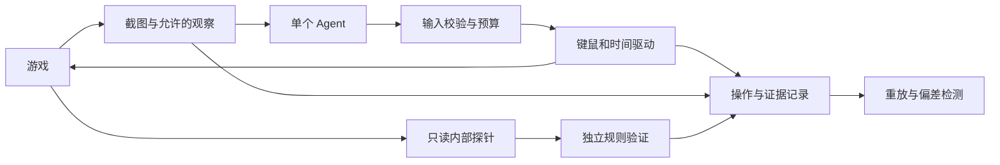

# GlitchHunter：单 Agent 游玩测试基础设施

## 首个交付

让一个策略通过截图、键鼠输入与有限的时间推进操作真实游戏。
先验证观察、输入和重放，再接视觉模型与 Fuzz 搜索。
当前代码包含浏览器基础设施、脚本基线及现有 DeepSeek Harness 的截图决策接入；Godot 桥接尚未实现。

## 数据通路与权限



策略输入只有截图、当前自身输入状态、公开执行反馈和剩余预算。
内部探针状态不传给策略。检查器是确定性宿主代码，不由探索模型修改。
模型输出只能是通过 schema 检查的输入数据，不能是 JavaScript、GDScript 或任意函数调用。
当前注入的 policy 函数是可信宿主代码；这不是用于执行不可信插件代码的沙箱。

人类与 Agent 复用同一游戏构建和输入处理路径。
观察可以后续扩展为显式声明的灰盒模式；评测要区分视觉与灰盒配置。

## 操作协议 v0.1

```json
{"held":["ArrowRight"],"buttons":[],"ticks":12}
```

held/buttons 表示本片段的完整持续按下状态；未列出的之前按键会松开。
相邻两次都包含同一个键表示持续按住，不会自动生成重复 keydown。
要连续点击/按键，需要插入松开片段。第一版尚未实现自动按键重复、滚轮、触屏、手柄或相对鼠标。
鼠标可指定 viewport 内的绝对位置和左右键。
同时按相反方向也是玩家能做的输入，应允许，不在适配层按设计意图过滤。

每次最多推进 240 个时间切片，整轮还有累计步数与 tick 预算。
这里的 tick 是驱动时间单位：hz=60 时 12 tick 是 200ms。
浏览器虚拟时钟控制不等于引擎物理步进，能力描述必须如实声明。

## 两种驱动

### 浏览器驱动（已实现最小版）

Playwright 创建隔离上下文，执行键盘 down/up、鼠标输入与截图。
在导航前安装虚拟时钟，模型思考时暂停，输入后 runFor 推进。
每次 reset 使用新上下文，避免上局 localStorage、按键或其他存储污染。
这能覆盖主页面定时器/rAF；不能自动保证 worker、网络、音频和所有 WebGL 游戏的确定性。

CSS 动画另有渲染时钟；在模型实测中，2048 初始截图曾因方块入场动画显示为空白。
该游戏的 demo 显式开启 screenshotAnimations=disabled，在截图时完成有限动画。
这是记录在轨迹中的游戏专用截图配置，不能不经验证应用到依赖动画事件的游戏。

seededHarness 是显式测试配置：启动前替换 Math.random。
必须在报告中记录，不将它描述成对原游戏随机性的完全保留。
原生模式不替换随机源时仍可操作，但不能凭同一个 seed 声称稳定复现。

### Godot 驱动（计划）

外部运行器通过本机 IPC 与游戏中的测试节点通信。
协议区分输入、截图、reset 与只读遥测；快照仅供宿主加速，不暴露给模型。

针对 Rest-in-Pieces 首先使用单人模式；Agent 控制 P1，内置电脑队友照常运行。
它使用物理键状态和原生鼠标事件，应通过对应 InputEventKey、InputEventMouseButton、InputEventMouseMotion 路径注入并做等效性验证。
单独 action_press 不会覆盖所有 `_input`/物理键分支。
禁止通过直接设置 move_dir、物体坐标、速度、抓取关系或 finished 完成玩家操作。

先实现渲染进程中的输入片段、暂停控制和截图；然后证明实际推进的物理帧数。
scene pause、SceneTreeTimer、process_always、Jolt 和输入事件消费的语义要逐项验证。
120Hz 固定频率本身不保证暂停/恢复能精确推进指定帧数。
截图需要有渲染器的进程，不能把无渲染的 headless 测试说成视觉游玩。
跨机器/版本的 3D 物理不承诺逐位一致，记录容差、事件和多次重放成功率。

## 两层决策

单个模型提出短期目标或实验，例如“走到门口后试着连续开门”。
确定性控制器负责短时间输入与及时观察，碰到碰撞、死亡、切换场景等事件可提前打断片段。
首版浏览器输入片段只在结束时观察，事件打断尚未实现。
远离关键点可使用稍长片段，交互和时序测试时缩短到少数 tick。
这避免把每一帧都变成一次模型调用，同时避免长动作错过关键反馈。

## 把 reward hacking 变成测试方法

把“任务目标”“搜索偏好”“缺陷判定”分开记录，不混为一个得分。

- 任务目标：正常送达、提高得分、缩短时间等，供探索策略追求。
- 搜索反馈：新区域、新事件组合、异常资源变化、假设测试结果。
- 独立判定：作者认可的硬规则、真实终点条件、崩溃与状态一致性。

让 Agent 优化一个有限预算下的代理目标，比较代理指标与独立任务判定：

| 现象 | 解释与处理 |
| --- | --- |
| 不行动所以不扣分 | 代理目标偏差/无进展，不自动报告为游戏漏洞。正常模式需真实目标完成。 |
| 重复相同路线刷访问次数 | 搜索计分问题，按归一化状态和事件去重并限制重复收益。 |
| 读档复制一次性物品 | 若违反作者规则且可重放，报告规则漏洞。 |
| 利用作者设计的弹簧板走近路 | 正常或意外玩法，由作者确认，不因绕路直接判错。 |
| 超长等待使计时指标更好 | 预算约束和独立计时核验，报告指标偏差的证据。 |

保留几种探索任务独立统计，第一版不急于拟合单一加权奖励函数。
没有训练模型也能采用这个思想：用模型提出假设，Fuzz 变异与策略选择扩展实验。
真正训练 RL 需要可重置环境、可信反馈、足够吞吐和基线，属于后续工作。

## 证据与重放

每轮保存 meta.json、trace.jsonl、逐步 PNG 和 summary.json。
记录构建指纹、浏览器版本、视口、时钟、PRNG 测试配置、初始探针状态、输入和后续检查点。
replay 不调用模型，比较每个探针检查点；无探针时只能称输入已重放，不能称缺陷已验证。
检查点匹配只证明被探针观察的字段一致，不等于完整引擎状态逐位一致。
重放不是发现确认的全部：问题仍需要硬规则或作者判定。
原始证据保留，缩减操作序列后应验证同一缺陷谓词，而不是“仍有任意错误”。

## 实施顺序与验收

1. 浏览器输入与录制：用真实 2048 验证按下、松开、暂停观察和重置。当前已做。
2. 在干净上下文重放，探针检查所有记录点，主动改坏检查点时必须检出偏差。当前已做测试。
3. 接视觉模型：已通过本机 DeepSeek Harness 复用 deepseek-account / deepseek-flash；模型成功调用 read_image 后返回按键。宿主展开为短按与松开，并记录两个原子输入。尚未实现长程任务完成和策略性恢复。
4. 接 Tiny-Platformer，验证持续移动、跳跃和自适应短动作。
5. 增加 Fuzz 轨迹库与三类漏洞策略，对比随机、正常目标、钻空子策略的发现成本。
6. 接最小 Godot demo，再接 Rest-in-Pieces 单人中国关第一个房间。

## Harness 接入边界

使用现有 dsh headless JSON 事件协议，逐决策启动，复用账号存储。
本次启动 patch 启用账号认证，关闭 shell、编辑、网页与委派等工具，并只保留图片读取。
额外工具守卫对任何工具执行做检查，只放行当前截图的 read_image，最多两次。
完整系统提示定义为游戏玩家，避免继承编程任务行为。
不读取凭据内容、不把凭据复制到项目中；Harness 自身正常读取原存储并记录会话和附件。
项目审计仅保存最终按键、简短可见现象与工具完成状态，不复制模型推理流。
每决策 90 秒超时，先终止进程组，未退出则强制清理；失败不伪装成自主动作成功。
每次提供最近最多六次按键，当前不是持久多轮 SDK session。

核查的是本机安装包 @deepseek-ai/dsh 0.2.1-rc.5。
相关 headless、tool-fs、tools 和 llm-deepseek-account README 与类型声明用于确认接口。
将来升级 Harness 后要重新核验 patch id、JSON 事件与图片能力，不能只依赖模型名称。

## 参考

- https://playwright.dev/docs/input
- https://playwright.dev/docs/clock
- https://docs.godotengine.org/en/stable/classes/class_input.html
- https://docs.godotengine.org/en/stable/classes/class_inputeventaction.html
- https://docs.godotengine.org/en/stable/classes/class_scenetree.html
- https://arxiv.org/abs/1803.03453
